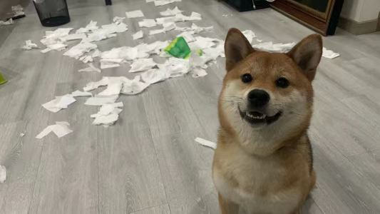

# 🐾 《高性价比狗生指南》（How To Raise Dog Better）

**一本面向所有养狗人、准养狗人与临时寄养照护者的开源、循证、反智商税养犬说明书**

> **灵感致敬**：本项目的结构化“算账 + 循证”写作框架，参考并致敬 GitHub 开源项目 [《高性价比人生指南》（eternity4719/HowToLiveBetter）](https://github.com/eternity4719/HowToLiveBetter)。
> 我们希望把这套理性务实的工程思维，用到每一只把十几年的生命交到我们手里的狗子身上——**拒绝焦虑营销，把有限的预算、时间和精力，花在最能延长健康陪伴的地方。**

> [!IMPORTANT]
> **免责声明**：本指南用于科学养宠科普、日常避坑与居家初筛参考，**不能替代执业兽医师的面对面临床诊断与治疗**。若狗狗出现[应急速查卡](book/00-一页纸应急速查卡.md)中的任意红灯急症，请立即前往正规动物医院就诊。

---

## 序｜这个项目从哪来

文章的起源，来自有一天自家狗子发生的意外行为：长时间盯着我看，哼唧，用力扒我，像是产生了一些不知道是啥的需求。

我一度以为是生病了，于是开始手忙脚乱地在家自查——翻看牙齿、试探脖颈反应、轻轻按压腹部看是否存在疼痛、想在家测体温……这一系列自查，引发了这份《高性价比狗生指南》。

### 0 号示范案例：有关我家狗子「糯米」

  

- **基本档案**：糯米｜柴犬｜约 **10 kg**｜写下此时已 4 岁多，进入漫长的青中年期
- **性格与萌点**：性格稳重、特别讨喜；只要有人对视就想过去打招呼，更别说“嘬嘬”了，直接兴奋得想和你原地交朋友；最喜欢被摸**右下巴**，舒服到原地瘫倒在地；只要是带响声的玩具，通宵也要把里面的哨子咬出来（⚠️ 拆破后必须立刻没收防误吞）。
- **两段真实就医复盘（给所有养狗人的前车之鉴）**：
  1. **急性胰腺炎（无保险，前后花费约 5,000 元）**：快 4 岁时发生。复盘起因是前几天偷吃了**带皮烤鸭的肥肉**；在家呕吐 1 天、观察呕吐物颜色后送医，查出胰腺炎指标**超标 10 倍**；第二天转至**南京农业大学教学动物医院（南农大动物医院）**复查确诊仍是胰腺炎，随后住院挂水康复。
  2. **偷吃提子催吐（已投保支付宝宠物险，直接走报销）**：胰腺炎康复后立刻配置了支付宝宠物保险。后续糯米偷吃了提子，上网核查风险后没有任何犹豫，直接送医院催吐成功把提子吐出来，避免了发展成急性肾衰竭，费用直接走保险报销。
  - **真实感悟**：买宠物保险最实在的红利是——**小问题直接走保险，不纠结费用、敢第一时间去医院把大隐患掐灭；大问题虽然额度未必全包，但心里也有底**。

相信每一只来到你身边的狗子，都会给你带来不一样的欢喜。

---

## 📖 全书目录

| 章节 | 内容入口 | 核心解决什么问题 |
| :--- | :--- | :--- |
| **速查卡** | [00｜一页纸应急速查卡](book/00-一页纸应急速查卡.md) | 建议打印贴冰箱/存手机相册：正常生命体征、红灯呕吐、致命毒物、催吐红线 |
| **总排行榜** | [11｜狗生高性价比总排行榜 & 避坑黑榜](book/11-狗生高性价比排行榜与避坑黑榜.md) | 全书最值 TOP 10 行动、四大独立口径分榜、8 大智商税避坑黑榜与口碑医院共创榜 |
| **第 01 章** | [01｜养前劝退与准入评估](book/01-养前劝退与准入评估.md) | 准备养狗前该想清什么：全周期账本、时间匹配、品种隐性医疗税、避开星期狗 |
| **第 02 章** | [02｜幼犬基建与行为打底](book/02-幼犬基建与行为打底.md) | 吃喝拉撒定点训练、护食正向纠正、社会化黄金期、绝育时机科学算账 |
| **第 03 章** | [03｜吃喝、防病与反智商税](book/03-吃喝防病与反智商税.md) | BCS 控体重延寿 1.8 年、居家刷牙、疫苗驱虫、补剂红黑榜、全年龄段体检周期 |
| **第 04 章** | [04｜居家自检与症状分诊](book/04-居家自检与症状分诊.md) | 5 分钟居家自检 SOP、狗狗不同呕吐颜色含义分诊表、哼唧扒人排查树 |
| **第 05 章** | [05｜避免意外与家庭急救](book/05-避免意外与家庭急救.md) | 提子酒石酸/烤鸭肥肉/人用药高危清单、黄金催吐窗口与红线、中暑与出行安全 |
| **第 06 章** | [06｜宠物保险、看病防坑与大病认知](book/06-宠物保险看病防坑与大病认知.md) | 糯米 5k 胰腺炎 vs 支付宝保险报销复盘、投保避坑、高校教学医院复查、大病认知库 |
| **第 07 章** | [07｜读懂狗子与开源扩展区](book/07-读懂狗子与开源扩展区.md) | 安定信号、疼痛识别、嗅闻丰容、预留给开发者的「狗狗表达 App」扩展构想 |
| **第 08 章** | [08｜短期寄养一页纸交接卡](book/08-短期寄养一页纸交接卡.md) | 托付朋友/寄养机构如何交代：糯米示范卡 + 空白通用模板 + 寄养方式对比 |
| **第 09 章** | [09｜老年犬照护指南](book/09-老年犬照护指南.md) | 老年半年一检升级包、300 元居家适老化四大件、关节止痛与老年痴呆照护 |
| **第 10 章** | [10｜最后一程：临终关怀与好好告别](book/10-最后一程与好好告别.md) | HHHHHMM 生活质量量表（70/35 分标准）、缓和医疗与安乐死认知、善后避坑 |

---

## 🧭 算账口径与证据分层

### 四大独立收益口径（不跨维度瞎折算）
1. **健康寿命**：降低发病率、延长高质量陪伴年限
2. **钱包安全**：花小钱避大病、躲开宠物消费智商税
3. **狗生体验**：少疼痛、低应激、情绪稳定
4. **养宠自由**：主人少崩溃、少内耗、人狗关系长期可持续

### 四级证据标签（详见证据库 [REFERENCES.md](REFERENCES.md)）
- **A 级**：国际兽医临床指南、大样本对照试验 / Meta 分析（WSAVA、AAHA、ACVIM、Merck）
- **B 级**：大样本流行病学统计、毒理/行为权威库（ASPCA、VetCompass、AVSAB、IRIS、CAPC）
- **C 级**：专业临床共识、国内高校动物医院教学科普（CVMA、南农大/中农大动物医院等）
- **M 级**：**民间高频实战经验**（真实账单、本土踩坑、寄养实战；单列标注，**红线是不与 A/B 级医学结论冲突**）

---

## 🤝 参与共创（大家一起完善）

这份说明书由发起人搭建框架并作为第一位参与者，借助 AI 检索核验权威兽医文献与整理民间经验，**非常欢迎所有养狗人、兽医、正向行为师与独立开发者共同完善**：

- 想补充一条高性价比经验、真实医院账单或地区踩坑？请提交 [New Entry Issue](.github/ISSUE_TEMPLATE/new-entry.md) 或直接发起 Pull Request。
- 发现任何医学数据过时、表述不严谨或需要补充最新文献？请提交 [Medical Correction Issue](.github/ISSUE_TEMPLATE/medical-correction.md)。
- 对「狗狗表达 / 行为日志 / 健康追踪 App」等工具生态感兴趣？欢迎在 [Extension Issue](.github/ISSUE_TEMPLATE/dog-app-extension.md) 讨论与共建。

详细规范请阅读 [CONTRIBUTING.md](CONTRIBUTING.md)。

---

## ❤️ 支持与赞赏（请糯米吃低脂冻干）

本指南完全开源免费。如果这份说明书帮你避开了一次智商税、或者在某个慌乱的深夜帮到过你和你的狗子：
- 点一个免费的 **Star ⭐** 或分享给正在养狗/准备养狗的朋友，就是最大的支持；
- 也可以点击仓库顶部的 **Sponsor（赞赏）** 按钮，请糯米吃一根低脂鸡胸肉冻干 🦴（放心，绝对不给它买烤鸭皮！）。

---

## 📄 开源协议

本项目采用 **[Creative Commons Attribution 4.0 International (CC BY 4.0)](LICENSE)** 协议开源——你可以自由分享、转载、二次改编或制作成小程序/单页阅读器，只需保留原作者与项目署名出处。
